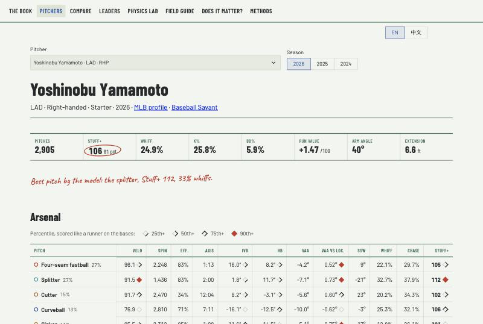
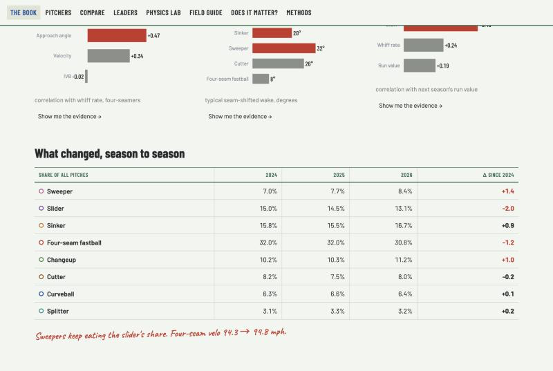

# DeepPitch — the physics scorebook of every MLB pitch

[](https://paul-2024mlb-deeppitch-analytics.streamlit.app/)


**Live:** https://paul-2024mlb-deeppitch-analytics.streamlit.app/

DeepPitch turns 2.14 million Statcast pitches (2024–2026) into plain-language physics. Watch any pitcher's arsenal fly, see the forces that bend each pitch, look up anyone in two clicks, and check — with real outcomes — whether those forces actually win at-bats.


<table><tr>
<td></td>
<td></td>
</tr><tr>
<td></td>
<td></td>
</tr></table>

## What's inside

| Page | What it answers |
|---|---|
| **The Book** | One arsenal in flight (side view + catcher's view, slow motion, the 175 ms commit point), the flight folio, three data-backed findings |
| **Pitchers** | Any pitcher-season: arsenal ledger with percentile diamonds, flight replay, movement vs. league, locations by batter hand, count usage, best tunnels, model explanation (SHAP), monthly trends |
| **Compare** | Up to four pitchers, one pitch type flown side by side |
| **Leaders** | Any pitch type × any metric × any minimum, with each metric's correlation to whiffs shown next to the ranking; CSV export |
| **Physics Lab** | Build a pitch from velocity, spin, efficiency, tilt and release, then fly it with the same force model the database uses |
| **Field Guide** | Every metric: what it is, what causes it, typical values, whether it matters, equations on demand; the original physics encyclopedia (Magnus, Bernoulli, SSW, approach geometry, the commit point) |
| **Does It Matter?** | Metric × pitch type correlation map against whiffs and run value, an explorer for any relationship, arm angle, bat tracking, pitch-mix trends |
| **Methods** | Pipeline, physics validated against public benchmarks, the Stuff+ model and its out-of-sample validation, limits |

English by default; **中文** switch in the top-right corner (or `?lang=zh`).

## Findings

- **Approach angle beats rise.** Across 1,082 pitcher-season four-seamers, average IVB barely relates to whiff rate (r = −0.02); vertical approach angle does (r = +0.47).
- **Sinkers move where spin says they can't.** The typical sinker's movement points about 20° away from its measured spin axis — seam-shifted wake.
- **Stuff predicts next year better than results.** Out-of-sample Stuff+ correlates 0.45 with next season's run value; a pitcher's own run value this season manages 0.19. Stuff+ is 0.76 correlated with itself year to year; run value only 0.19.
- **The sweeper keeps taking over.** Sweeper usage rose from 7.0% to 8.4% of all pitches between 2024 and 2026 while the traditional slider fell from 15.0% to 13.1%.

## How it works

```
Baseball Savant ──► fetch.py ──► features.py ──► model.py ──► aggregate.py ──► Streamlit app
 (pybaseball,        raw parquet    clean + physics   LightGBM Stuff+    ~17 MB of compact
  6-day chunks)      per season     engine            leave-one-season   parquet tables
                                                      -out + TreeSHAP
```

**Physics engine** (`deeppitch/physics.py`, unit-tested): every trajectory is rebuilt from Statcast's 9-parameter constant-acceleration fit, anchored at the measured plate location.

- Approach angles (VAA/HAA) at the front of the plate, plus a location-adjusted VAA (residual of VAA on pitch height, per season × pitch type)
- Magnus acceleration = total acceleration − gravity − the drag component along the velocity
- Spin efficiency = Magnus acceleration ÷ (speed × spin), calibrated so the 98th-percentile four-seamer = 100%
- Seam-shifted wake = angle between the Hawk-Eye spin axis and the movement direction (mirrored for left-handers)
- Tunneling = distance between consecutive different pitch types at the commit point (175 ms before the plate) vs. at the plate, in true pitch order

**Stuff+** (`pipeline/model.py`): LightGBM predicts Statcast run value from physics only (velocity, spin, efficiency, movement, release, arm angle, SSW, differences from the pitcher's fastball, platoon). Each season is scored by a model trained on the other seasons, so every grade in the app is out-of-sample. 100 = league average; 10 points = one standard deviation.

### What changed from v1

v1 (2024 only) had four metric errors that this version fixes: perceived velocity averaged 105 mph (now Statcast effective speed), "SSW" mostly measured gyro spin (now the spin-axis/movement angle), tunneling double-counted gravity and ignored pitch order, and spin efficiency was ranked across pitch types. Horizontal break is now mirrored for left-handers.

## Run it

```bash
python -m venv .venv && source .venv/bin/activate
pip install -r requirements.txt
streamlit run app.py
```

The app reads only `data/app/` (committed). To rebuild everything from Baseball Savant (≈20 min fetch + ≈5 min model):

```bash
pip install -r requirements-pipeline.txt
python -m pipeline.run 2024 2025 2026
pytest
```

## Repository

```
app.py                 navigation + theme
app_pages/             one file per page
deeppitch/             physics engine, simulator, theme, charts, components, i18n
deeppitch/web/         animated flight canvas (HTML/JS)
pipeline/              fetch → features → model → aggregate
data/app/              compact tables the app ships with
tests/                 physics unit tests + page smoke tests (both languages)
```

## 中文簡介

DeepPitch 把 2024–2026 年共 214 萬顆 Statcast 投球轉成白話的物理。你可以看任何投手的球路實際飛行（側視圖＋捕手視角、慢動作、175 毫秒出棒決策點）、看到讓球轉彎的力量、兩次點擊查到任何投手，並用真實結果驗證這些力量是否真的贏得打席。

- **投手頁**：球路計分表（以壘包菱形表示百分位）、飛行重播、與聯盟比較的位移圖、對左右打的進壘位置、球數配球、最佳隧道組合、模型解釋（SHAP）、月趨勢
- **物理實驗室**：用球速、轉速、旋轉效率、轉軸傾角、出手點自己做一顆球並讓它飛
- **指標圖鑑**：每個指標是什麼、成因、常見數值、有沒有用；保留並改寫原本的物理百科（馬格努斯、白努利、縫線偏移尾流、進壘幾何、出棒決策點）
- **方法與模型**：資料管線、物理數值與公開基準比對、Stuff+ 模型的樣本外驗證與限制

## Author

**Paul Lai (Hong-Min Lai)** — M.S. in Data Science, University of California, San Diego
[paul262935@gmail.com](mailto:paul262935@gmail.com) · [LinkedIn](https://www.linkedin.com/in/paullai0111/)

Data: MLB Statcast via Baseball Savant. Not affiliated with MLB.
