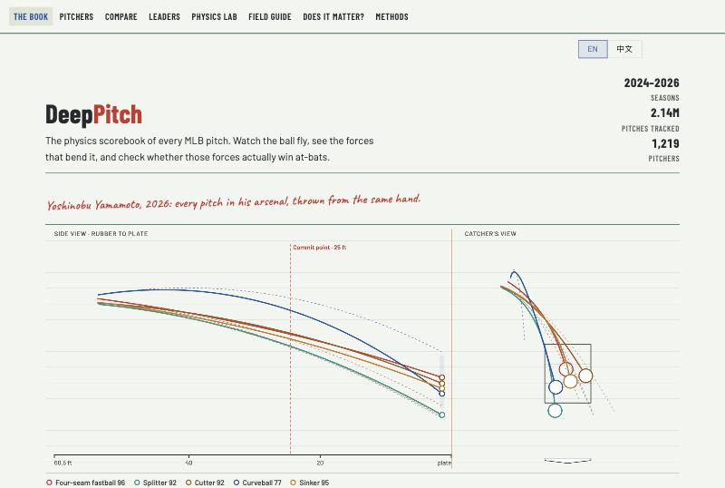
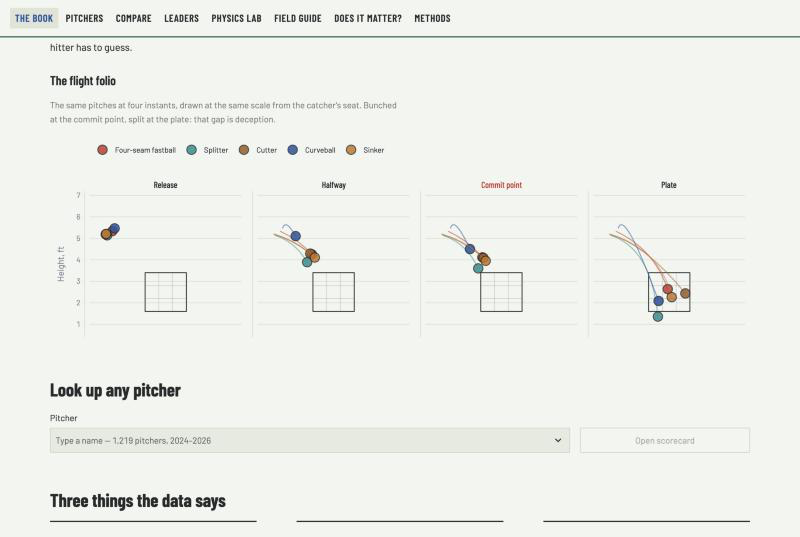
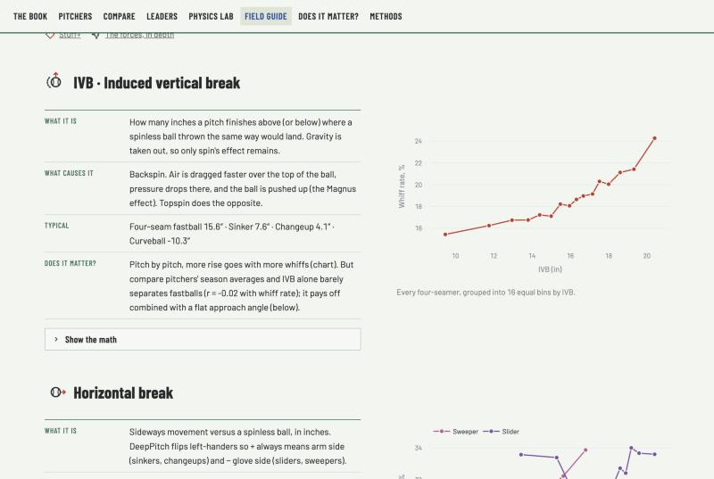

# DeepPitch — the physics scorebook of every MLB pitch

[](https://paul-2024mlb-deeppitch-analytics.streamlit.app/)


**Live:** https://paul-2024mlb-deeppitch-analytics.streamlit.app/

DeepPitch turns 2.14 million Statcast pitches (2024–2026) into plain-language physics. Watch any pitcher's arsenal fly, see the forces that bend each pitch, look up anyone in two clicks, and check — with real outcomes — whether those forces actually win at-bats.



<table><tr>
<td></td>
<td></td>
</tr><tr>
<td></td>
<td></td>
</tr></table>

## What's inside

| Page | What it answers |
|---|---|
| **The Book** | One arsenal in flight (side view + catcher's view, slow motion, the 175 ms commit point), the flight folio, three data-backed findings |
| **Pitchers** | Any pitcher-season: arsenal ledger with percentile diamonds, flight replay, movement vs. league, locations by batter hand, count usage, best tunnels, model explanation (SHAP), monthly trends |
| **Compare** | Up to four pitchers, one pitch type flown side by side |
| **Leaders** | Any pitch type × any metric × any minimum, with each metric's correlation to whiffs shown next to the ranking; CSV export |
| **Physics Lab** | Build a pitch from velocity, spin, efficiency, tilt and release, then fly it with the same force model the database uses |
| **Field Guide** | Every metric: what it is, what causes it, typical values, whether it matters, equations on demand; the original physics encyclopedia (Magnus, Bernoulli, SSW, approach geometry, the commit point) |
| **Does It Matter?** | Metric × pitch type correlation map against whiffs and run value, an explorer for any relationship, arm angle, bat tracking, pitch-mix trends |
| **Methods** | Pipeline, physics validated against public benchmarks, the Stuff+ model and its out-of-sample validation, limits |

English by default; **中文** switch in the top-right corner (or `?lang=zh`).

## Findings

- **Approach angle beats rise.** Across 1,082 pitcher-season four-seamers, average IVB barely relates to whiff rate (r = −0.02); vertical approach angle does (r = +0.47).
- **Sinkers move where spin says they can't.** The typical sinker's movement points about 20° away from its measured spin axis — seam-shifted wake.
- **Stuff predicts next year better than results.** Out-of-sample Stuff+ correlates 0.45 with next season's run value; a pitcher's own run value this season manages 0.19. Stuff+ is 0.76 correlated with itself year to year; run value only 0.19.
- **The sweeper keeps taking over.** Sweeper usage rose from 7.0% to 8.4% of all pitches between 2024 and 2026 while the traditional slider fell from 15.0% to 13.1%.

## How it works

```
Baseball Savant ──► fetch.py ──► features.py ──► model.py ──► aggregate.py ──► Streamlit app
 (pybaseball,        raw parquet    clean + physics   LightGBM Stuff+    ~17 MB of compact
  6-day chunks)      per season     engine            leave-one-season   parquet tables
                                                      -out + TreeSHAP
```

**Physics engine** (`deeppitch/physics.py`, unit-tested): every trajectory is rebuilt from Statcast's 9-parameter constant-acceleration fit, anchored at the measured plate location.

- Approach angles (VAA/HAA) at the front of the plate, plus a location-adjusted VAA (residual of VAA on pitch height, per season × pitch type)
- Magnus acceleration = total acceleration − gravity − the drag component along the velocity
- Spin efficiency = Magnus acceleration ÷ (speed × spin), calibrated so the 98th-percentile four-seamer = 100%
- Seam-shifted wake = angle between the Hawk-Eye spin axis and the movement direction (mirrored for left-handers)
- Tunneling = distance between consecutive different pitch types at the commit point (175 ms before the plate) vs. at the plate, in true pitch order

**Stuff+** (`pipeline/model.py`): LightGBM predicts Statcast run value from physics only (velocity, spin, efficiency, movement, release, arm angle, SSW, differences from the pitcher's fastball, platoon). Each season is scored by a model trained on the other seasons, so every grade in the app is out-of-sample. 100 = league average; 10 points = one standard deviation.

### What changed from v1

v1 (2024 only) had four metric errors that this version fixes: perceived velocity averaged 105 mph (now Statcast effective speed), "SSW" mostly measured gyro spin (now the spin-axis/movement angle), tunneling double-counted gravity and ignored pitch order, and spin efficiency was ranked across pitch types. Horizontal break is now mirrored for left-handers.

## User guide · 使用說明

<details>
<summary><b>User guide (English)</b> — click to expand</summary>

### Three-minute start
1. On **The Book**, press the red **Throw** button under the flight canvas and pick **⅒×** to watch one pitcher's whole arsenal fly to the plate in slow motion.
2. Watch the dashed red **Commit point**: before it the pitches look almost identical; they only split after it.
3. Type any name in **Look up any pitcher** and press **Open scorecard**.
4. Not sure what a number means? Look it up in the **Field Guide**.
5. Want to build your own pitch? Go to the **Physics Lab**.

The site opens in English; switch to Traditional Chinese with **中文** in the top-right corner or add `?lang=zh` to the URL.

### Reading the symbols
| Symbol | Meaning |
|---|---|
| **Base-path diamond** | Percentile within the same pitch type and season, scored like a runner: first base = 25th+, second = 50th+, third = 75th+, **filled red = 90th+**. Hover for the exact number. |
| **Red** | What matters: the commit point, the circled key stat, model contributions that help the pitcher, big season-to-season changes. Four-seamers are also drawn in red. |
| **Blue** | Your current selection (tabs, buttons, navigation). |
| **Handwritten red note** | The scorer's note: one takeaway written from the data. |
| **Dashed path** | Where the same throw would go with no spin (gravity and drag only). The gap to the solid path is what spin does. |
| **HB sign** | Always arm side = +, glove side = −, so left- and right-handers compare on one scale. |

### Pages
- **The Book** — The flight canvas has a side view (rubber to plate) and a catcher's view. Controls: **Throw** (play/pause), **1× / ⅒× / 1⁄30×** speed, **No-spin path** toggle, and a scrubber to stop at any millisecond. Below it, the **flight folio** shows the same pitches at release, halfway, the commit point and the plate, all at one scale. Then come three findings with their evidence and the season-to-season pitch mix.
- **Pitchers** — Pick a pitcher and season (the URL becomes `?id=…`, so you can share it).
  - **Stat line**: pitches, Stuff+ (circled), whiff %, K %, BB %, run value per 100, arm angle, extension.
  - **Arsenal**: usage, velocity, spin, spin efficiency, axis (clock), IVB, HB, VAA, location-adjusted VAA, SSW, whiff, chase, Stuff+. Scroll sideways on wide tables; the first column stays put.
  - **Flight** and **Movement** (each dot is a pitch, the big circle is the average, faint squares are the league).
  - **Locations**: heat maps vs right- and left-handed hitters; hover for whiff %.
  - **Sequencing & tunnels**: pitch mix by count state, plus the best tunnel pairs.
  - **Why the model grades it**: which traits push Stuff+ up (red) or down (gray).
  - **Season trend**: monthly velocity, IVB, HB, spin and Stuff+.
- **Compare** — Up to four pitchers. Pick a pitch type to fly them together, compare them in one table, then see each full movement chart.
- **Leaders** — Choose season → pitch type → metric → minimum pitches. The caption shows how strongly that metric relates to whiffs. Export the top 25 as CSV. Also includes whole-staff Stuff+ and whiff leaders and the league's best tunnels. Click a name to open the scorecard.
- **Physics Lab** — Start from a classic (riding four-seam, heavy sinker, sweeper, big curve, splitter, gyro slider) or set velocity, spin, spin efficiency, spin tilt (12:00 = pure backspin, 1:00 typical four-seam, 2:00–2:30 sinker, 6:00 pure topspin, 9:00 pure glove-side), release height, extension and target height. You get IVB, HB, VAA, flight time, useful spin and Magnus force, and see your pitch placed among real ones.
- **Field Guide** — Every metric in four rows: what it is, what causes it, typical values, does it matter. A real-data chart sits beside each one, and **Show the math** expands the equations. The physics encyclopedia (Magnus, Bernoulli, air density, approach geometry, the commit point) is at the bottom.
- **Does It Matter?** — A correlation map of metric × pitch type against whiffs or run value (red = more of the trait goes with better results), an explorer for any relationship, arm angle vs four-seam rise, bat speed by pitch type, and pitch-mix trends.
- **Methods** — The pipeline, physics checked against public benchmarks, the Stuff+ model and its validation, and the limits.

### FAQ
- **What does Stuff+ 100 mean?** League average that season; every 10 points is one standard deviation. It only looks at the ball's physics, not command, the hitter or luck.
- **Why is a pitcher missing a season?** Too few tracked pitches: a pitch type needs 50+ to be listed, and 100+ for percentiles and leaderboards.
- **Why do two pitchers with the same spin rate move so differently?** Check spin efficiency (how much of that spin is useful) and SSW (how much the seams add).

</details>

<details>
<summary><b>使用說明（中文）</b> — 點開查看</summary>

### 三分鐘上手
1. 在首頁按軌跡圖下方紅色的 **Throw（投球）**，選 **⅒×**，慢動作看一位投手的所有球路飛向本壘。
2. 注意紅色虛線 **Commit point（出棒決策點）**：在它之前，各種球路看起來幾乎一樣，過了這條線才分開。
3. 在 **Look up any pitcher** 輸入任何投手姓名，按 **Open scorecard** 開啟他的計分卡。
4. 不懂某個數字，到 **Field Guide（指標圖鑑）** 查。
5. 想自己做一顆球，到 **Physics Lab（物理實驗室）**。

網站預設英文；右上角 **中文** 可切換，或在網址加 `?lang=zh`。

### 符號說明
| 符號 | 意思 |
|---|---|
| **壘包菱形** | 同球種、同賽季的百分位，像計分簿記跑壘：上一壘 = 25 以上、二壘 = 50、三壘 = 75、**整個塗紅 = 90 以上**。滑鼠移上去可看精確數字。 |
| **紅色** | 重點：決策點、被圈起來的關鍵數據、對投手有利的模型貢獻、明顯的年度變化。四縫線也用紅色。 |
| **藍色** | 你目前選取的項目（頁籤、按鈕、導覽列）。 |
| **手寫紅字** | 計分員筆記：根據資料寫出的一句重點。 |
| **虛線軌跡** | 同樣出手但完全沒有旋轉時的路徑（只有重力與阻力）；和實線的差距就是旋轉造成的位移。 |
| **HB 正負號** | 一律手臂側為 +、手套側為 −，左右投可以在同一尺度上比較。 |

### 各頁說明
- **The Book（總覽）**：軌跡動畫分成側視圖與捕手視角。控制列有 **Throw**（播放／暫停）、**1× / ⅒× / 1⁄30×** 速度、**No-spin path**（無旋轉虛線）開關，以及可拖曳到任何毫秒的時間軸。下方的**飛行圖鑑**以同比例呈現出手、飛行一半、決策點、本壘四個瞬間。接著是三個附證據的發現，以及各球種的年度使用率變化。
- **Pitchers（投手）**：選投手與賽季（網址會變成 `?id=…`，可直接分享）。
  - **計分列**：投球數、Stuff+（紅圈）、揮空率、K%、BB%、每百球失分價值、手臂角度、延伸。
  - **球路組成**：使用率、球速、轉速、旋轉效率、轉軸（時鐘）、IVB、HB、VAA、位置校正 VAA、SSW、揮空、追打、Stuff+。表格較寬時可左右滑動，第一欄固定。
  - **飛行**與**位移**：每點是一顆球，大圓圈是平均，淡色方塊是全聯盟分布。
  - **進壘位置**：對左右打的熱圖，滑鼠移上去看揮空率。
  - **配球與隧道**：各球數狀態的配球比例，以及最佳隧道組合。
  - **模型評分原因**：哪些物理特性讓 Stuff+ 變高（紅）或變低（灰）。
  - **賽季趨勢**：每月的球速、IVB、HB、轉速、Stuff+。
- **Compare（比較）**：最多 4 位投手。選球種後同場飛行、並排比較，下方是每位投手的完整位移圖。
- **Leaders（排行榜）**：依序選賽季、球種、指標、最少球數。標題下方會列出該指標與揮空率的相關強度。可下載前 25 名 CSV，另有全投手 Stuff+／揮空率排行與全聯盟最佳隧道組合。點姓名可開啟計分卡。
- **Physics Lab（物理實驗室）**：從經典球路開始（上竄四縫線、重伸卡、橫掃、大曲球、指叉、陀螺滑球），或自行調整球速、轉速、旋轉效率、轉軸傾角、出手高度、延伸、目標高度。轉軸傾角：12:00 純倒旋、1:00 典型四縫線、2:00–2:30 伸卡、6:00 純上旋、9:00 純手套側。結果會顯示 IVB、HB、VAA、飛行時間、有效轉速、馬格努斯力，並把你的球放到真實分布上比較。
- **Field Guide（指標圖鑑）**：每個指標分四格說明：是什麼、成因、常見數值、有沒有用，旁邊附真實資料圖。**Show the math** 可展開公式。頁尾是物理百科：馬格努斯、白努利、空氣密度、進壘幾何、出棒決策點。
- **Does It Matter?（真的有用嗎？）**：指標 × 球種相對揮空率或 run value 的相關熱圖（紅 = 特性越多、結果越好）、任意關係探索、手臂角度與四縫線上竄、各球種揮棒速度、球種配置趨勢。
- **Methods（方法與模型）**：資料管線、與公開基準的物理比對、Stuff+ 模型與驗證、限制。

### 常見問題
- **Stuff+ 100 代表什麼？** 當季聯盟平均，每 10 分 = 一個標準差。只看球本身的物理，不看控球、打者與運氣。
- **為什麼查不到某位投手的某個賽季？** 追蹤球數不足：某球種要 50 球以上才會列出，百分位與排行需 100 球以上。
- **為什麼兩位轉速相同的投手位移差很多？** 看旋轉效率（有多少轉速是有效的）和 SSW（縫線額外推了多少）。

</details>

## Run it

```bash
python -m venv .venv && source .venv/bin/activate
pip install -r requirements.txt
streamlit run app.py
```

The app reads only `data/app/` (committed). To rebuild everything from Baseball Savant (≈20 min fetch + ≈5 min model):

```bash
pip install -r requirements-pipeline.txt
python -m pipeline.run 2024 2025 2026
pytest
```

## Repository

```
app.py                 navigation + theme
app_pages/             one file per page
deeppitch/             physics engine, simulator, theme, charts, components, i18n
deeppitch/web/         animated flight canvas (HTML/JS)
pipeline/              fetch → features → model → aggregate
data/app/              compact tables the app ships with
tests/                 physics unit tests + page smoke tests (both languages)
```

## 中文簡介

DeepPitch 把 2024–2026 年共 214 萬顆 Statcast 投球轉成白話的物理。你可以看任何投手的球路實際飛行（側視圖＋捕手視角、慢動作、175 毫秒出棒決策點）、看到讓球轉彎的力量、兩次點擊查到任何投手，並用真實結果驗證這些力量是否真的贏得打席。

- **投手頁**：球路計分表（以壘包菱形表示百分位）、飛行重播、與聯盟比較的位移圖、對左右打的進壘位置、球數配球、最佳隧道組合、模型解釋（SHAP）、月趨勢
- **物理實驗室**：用球速、轉速、旋轉效率、轉軸傾角、出手點自己做一顆球並讓它飛
- **指標圖鑑**：每個指標是什麼、成因、常見數值、有沒有用；保留並改寫原本的物理百科（馬格努斯、白努利、縫線偏移尾流、進壘幾何、出棒決策點）
- **方法與模型**：資料管線、物理數值與公開基準比對、Stuff+ 模型的樣本外驗證與限制

## Author

**Paul Lai (Hong-Min Lai)** — M.S. in Data Science, University of California, San Diego
[paul262935@gmail.com](mailto:paul262935@gmail.com) · [LinkedIn](https://www.linkedin.com/in/paullai0111/)

Data: MLB Statcast via Baseball Savant. Not affiliated with MLB.
